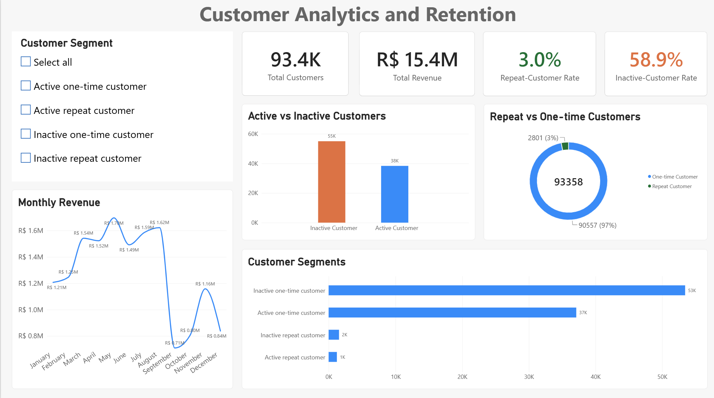

## Dashboard Preview



# Customer Analytics & Retention Dashboard

An end-to-end customer analytics project for the Olist Brazilian e-commerce dataset.  
The project uses Python for data cleaning, SQL for analysis, and Power BI for dashboard development.

## Business Problem

Olist needs to understand its customer base, identify repeat customers, detect inactive customers, and monitor revenue trends. This project helps the business understand customer retention and churn risk.

## Tools Used

- Python (pandas, numpy, matplotlib)
- SQL
- Power BI
- Power Query
- GitHub

## Dataset

- Source: Olist Brazilian E-commerce Public Dataset
- Customers analysed: 93,358 unique customers
- Currency: Brazilian Real (R$)

## Dashboard Features

- Total customers, total revenue, repeat-customer rate, and inactive-customer rate
- Customer-segment slicer
- Customers by segment
- Monthly revenue trend
- Repeat vs one-time customers
- Active vs inactive customers

## Key Insights

- The dataset contains 93,358 unique customers and R$ 15.4 million in total revenue.
- Only 3.0% of customers are repeat customers.
- 58.9% of customers are inactive.
- The largest customer segment is Inactive One-Time Customer, with approximately 53,000 customers.
- Revenue was highest in February and lowest in April.
- The high inactive-customer rate indicates a major customer-retention risk.

## Recommendations

1. Create re-engagement campaigns for inactive one-time customers.
2. Offer personalised discounts or product recommendations to encourage repeat purchases.
3. Monitor the inactive-customer rate regularly.
4. Investigate the revenue decline in April and learn from the February performance.
5. Use customer-segment analysis to target marketing campaigns.

## Repository Structure

```text
data/
  raw/
  cleaned/
python/
  customer_analysis.ipynb
sql/
  customer_analysis.sql
powerbi/
  customer_analytics_and_retention_dashboard.pbix
docs/
  cleaning_steps.md
  insights_and_recommendations.md
Readme.md
```

## How to View

1. Download or clone this repository.
2. Open `python/customer_analysis.ipynb` to review the data cleaning and retention analysis.
3. Open `sql/customer_analysis.sql` to review the analysis queries.
4. Open `powerbi/customer_analytics_and_retention_dashboard.pbix` in Power BI Desktop.
5. Use the Customer Segment slicer to filter the dashboard.
6. Review `docs/insights_and_recommendations.md` for the main findings.
